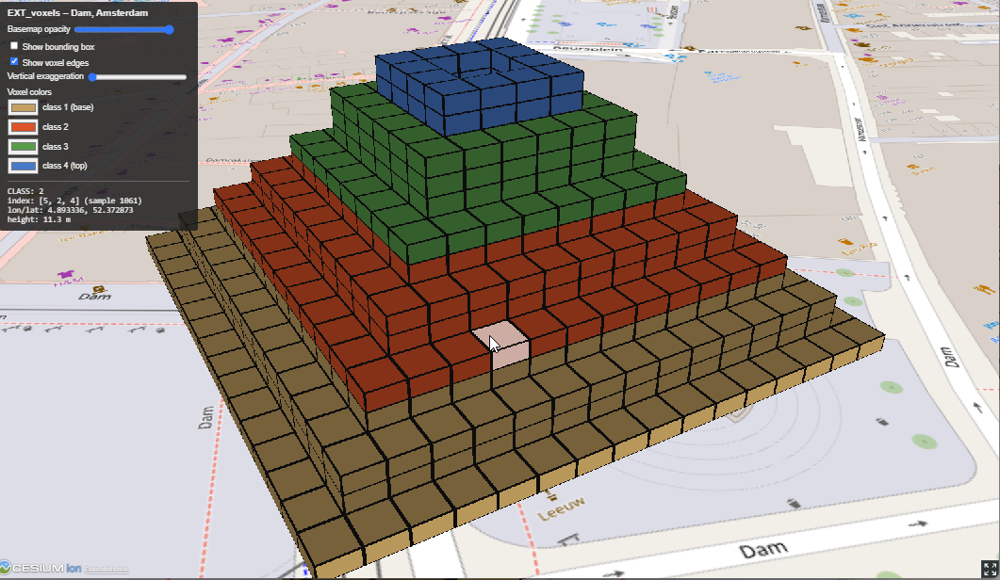

# VoxelsAmsterdamDam

Console sample that uses SharpGLTF with the `EXT_voxels` glTF extension (from `SharpGLTF.Ext.3DTiles`) to write a small
voxel tileset located on the Dam square in Amsterdam, plus a CesiumJS page to view it.


The sample generates:

- `tile.glb` - a glTF with one node using `EXT_voxels`: a 16x16x16 grid with a `CLASS` attribute (byte, 0 = empty / no data, 1-4 = classes)
- `tileset.json` - a 3D Tiles tileset with a single box tile, positioned at the Dam (lon 4.89352, lat 52.37312) through an east-north-up transform
- `index.html` - a CesiumJS 1.146 viewer, copied to the output directory by the build

## Run

From this directory:

```
dotnet run
```

This writes `tile.glb` and `tileset.json` next to the copied `index.html`, in the build output directory
(`bin/Debug/net8.0/`). To write them somewhere else, pass a directory:

```
dotnet run -- <outputDirectory>
```

Note that `index.html` is only copied to the build output directory, so for a custom directory copy it there yourself.

## View

`index.html` loads `tileset.json` and `tile.glb` with `fetch`, so it must be served over HTTP (opening the file directly does not work).
Serve the output directory with any static web server, for example:

```
cd bin/Debug/net8.0
npx http-server -p 8080
```

Then open <http://localhost:8080/index.html>. An internet connection is needed for CesiumJS (CDN) and the OpenStreetMap basemap.

In the viewer you can:

- click a voxel to see its attributes (class value, grid index, position)
- change the color of each class
- toggle voxel edges and the bounding box
- change the basemap opacity and the vertical exaggeration

## Notes

- CesiumJS has no loader for `EXT_voxels` (a glTF 2.1 draft extension) yet. `index.html` reads `tileset.json` and the `EXT_voxels` node
  of `tile.glb` itself and feeds the data to Cesium's (experimental) `VoxelPrimitive` through `Cesium3DTilesVoxelProvider`.
- The voxel data is stored x first, then y (north), then z (up). The viewer sets the provider metadata order accordingly.
- The tile is placed at ellipsoid height 0 because the viewer uses a flat ellipsoid basemap without terrain.
